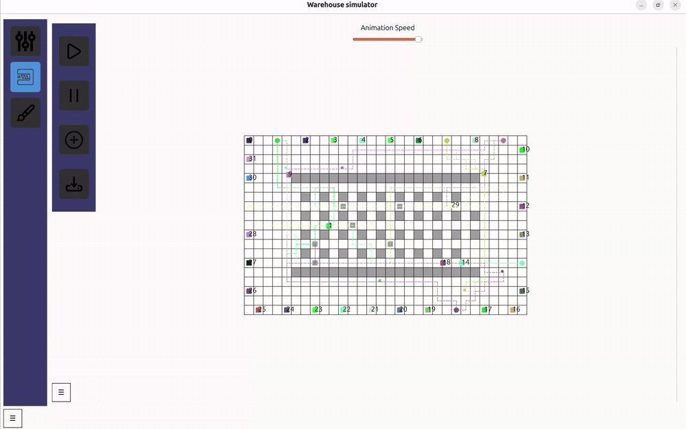

# TSP-MAPF · Warehouse Robot Simulator

[](https://github.com/MateuszAmbrozy/TSP-MAPF/actions/workflows/ci.yml)

A C++17 / Qt project exploring **multi-agent pickup and delivery** on a warehouse grid. It combines pickup ordering with cooperative path planning and provides a desktop editor and animated simulation.

Developed by **Mateusz Ambroży** as an engineering thesis project. The repository name refers to Traveling Salesman Problem (TSP) and Multi-Agent Path Finding (MAPF); the application models pickup-and-delivery tasks (MAPD).



*20-second excerpt from the desktop simulator, shown at the recorded speed. [Screenshots and full recordings](#desktop-demo) below.*

## What it demonstrates

- **Route ordering:** a 2-opt heuristic reorders a task group's pickup points while keeping the start and dropoff fixed.
- **Grid pathfinding:** A* searches a four-connected grid with obstacles.
- **Multi-agent coordination:** Cooperative A* and a windowed cooperative implementation use reservations over space and time.
- **Warehouse model:** agents have capacity limits, pickup/dropoff locations and service times.
- **Desktop tooling:** create maps, save/load JSON scenarios, choose a planner and animate agent movement.
- **Reusable core:** the algorithms build independently of Qt, with a small console example and CTest checks.

This is an educational simulation and research prototype. See [limitations](#limitations) for the scope of its guarantees.

## Desktop demo

The Qt application includes a warehouse editor and an animation view for watching agents navigate the grid.

| Warehouse editor | Multi-agent simulation |
| --- | --- |
|  |  |
| Prepare a warehouse layout and configure agent capacities. | Watch agent movement with start/pause and speed controls. |

<details>
<summary>Full recordings — task setup and simulator walkthrough</summary>

| Recording | Duration | What it shows |
| --- | --- | --- |
| [Task setup on a small map](examples/Screencast%20from%202026-10-19%2012-44-03.webm) | 1:26 · ~2 MB | A small simulation and the task dialog, including pickup/dropoff selection and service-time inputs. |
| [Warehouse simulation and editor walkthrough](examples/Screencast%20from%202026-10-19%2012-47-34.webm) | 2:08 · ~8 MB | Agent movement in a larger warehouse, map loading, the editor, capacity inputs and saving a map. |

The links open the original WebM files; download them if a preview is unavailable. The recordings show additional layouts beyond the small bundled `warehouse.json` example.

</details>

## Build and run

Requirements: **CMake 3.16+**, a **C++17 compiler**, and **Qt 5 or Qt 6 Widgets** for the desktop application. The core has no external dependencies.

### Desktop application

On Ubuntu / Debian, install the build tools and Qt development packages:

```sh
sudo apt-get update
sudo apt-get install build-essential cmake qt6-base-dev libqt6svg6
```

```sh
git clone https://github.com/MateuszAmbrozy/TSP-MAPF.git
cd TSP-MAPF
cmake -S . -B build -DCMAKE_BUILD_TYPE=Release
cmake --build build --config Release --parallel
./build/tsp_mapf_gui
```

On Windows, use a Qt kit matching your compiler and architecture. If CMake cannot find Qt, pass `-DCMAKE_PREFIX_PATH="<Qt installation>/<version>/<kit>"` when configuring. With Visual Studio generators, executables are in `build/Release/`.

Qt Creator can open the root `CMakeLists.txt`. The older `visualization_qt/menu.pro` remains available for qmake users; CMake is the primary build entry point.

### Core-only demo and tests

```sh
cmake -S . -B build-core -DTSP_MAPF_BUILD_GUI=OFF -DCMAKE_BUILD_TYPE=Release
cmake --build build-core --config Release --parallel
./build-core/tsp_mapf_demo
ctest --test-dir build-core -C Release --output-on-failure
```

The console demo prints an optimized pickup order and an A* grid distance. It does not run the multi-agent GUI simulation.

## Try the simulator

1. Open **General** and select Cooperative A* or the windowed planner.
2. Open **Animation**, click **Upload map** and select [`examples/warehouse.json`](examples/warehouse.json).
3. Use **Add Task** to prepare a pickup/delivery task, then **Start** to advance the simulation. **Stop** pauses it; the slider adjusts animation speed.
4. Use **Editor** to create and save your own maps.

Selecting Animation again creates a fresh simulation view. Load a map before starting or adding a task.

## Scenario format

The bundled example is a 12 × 8 grid with two agents, shelf obstacles, three pickup locations and two dropoff locations. Coordinates are zero-based: `0 <= x < width`, `0 <= y < height`.

| JSON field | Meaning |
| --- | --- |
| `width`, `height` | Grid dimensions |
| `agents` | Starting positions and capacities: `{ "x": 0, "y": 0, "capacity": 15 }` |
| `obstacles` | Blocked cells, each with `x` and `y` |
| `avaliablePickups` | Allowed pickup cells |
| `avaliableDropoffs` | Allowed delivery cells |

The spelling `avaliable…` is preserved for compatibility with the existing editor. Keep agent starts distinct, use positive capacities and place starts, pickups and dropoffs on traversable cells. The GUI importer does not yet fully validate arbitrary input files.

## How the pieces fit

```text
Qt editor / animation
        │
        ▼
CA_Environment / WCA_Environment
        ├── capacity-based agent selection
        ├── TSP: pickup ordering with 2-opt
        └── cooperative planner + reservation table
                    │
                    ▼
             timed agent paths
```

| Location | Contents |
| --- | --- |
| `lib/`, `src/` | Core model, A*, TSP, cooperative planners and environments |
| `visualization_qt/` | Qt Widgets views, map editor, scenes and resources |
| `examples/` | Ready-to-load JSON scenario, GUI screenshots and full demo recordings |
| `tests/` | Core regression checks |
| `docs/` | Research papers, original class diagram and technical notes |
| `.github/workflows/` | Core builds on Linux/Windows and Qt build on Linux |

Read [the architecture and verification notes](docs/architecture.md) for implementation details and remaining work.

## Limitations

- The TSP component is a **local-search heuristic**, not an exact solver. Its distance matrix uses Euclidean distances, so pickup ordering does not account for walls or other agents.
- Cooperative planning is prioritized/windowed. There is no claim of completeness, global optimality, or deadlock-free operation for arbitrary scenarios.
- Automated checks cover A*, reservation-table operations, basic 2-opt behavior and the console demo. They do not establish collision freedom of complete multi-agent runs or GUI correctness.
- GUI input validation, simulation ownership and task scheduling still need broader hardening. This repository does not include reproducible performance benchmarks.

## Research background

The project was developed using the following locally included references:

- [TSP–MAPF paper](docs/tsp-mapf.pdf)
- [Cooperative pathfinding](docs/coop-path-AIIDE.pdf)
- [Space-time A*](docs/spaceTimeAstar.pdf)
- [Traveling Salesman Problem](docs/traditional_tsp.pdf)

These papers are background material; the project does not claim to reproduce every method or result in them. Third-party documents retain their original authorship and rights.
